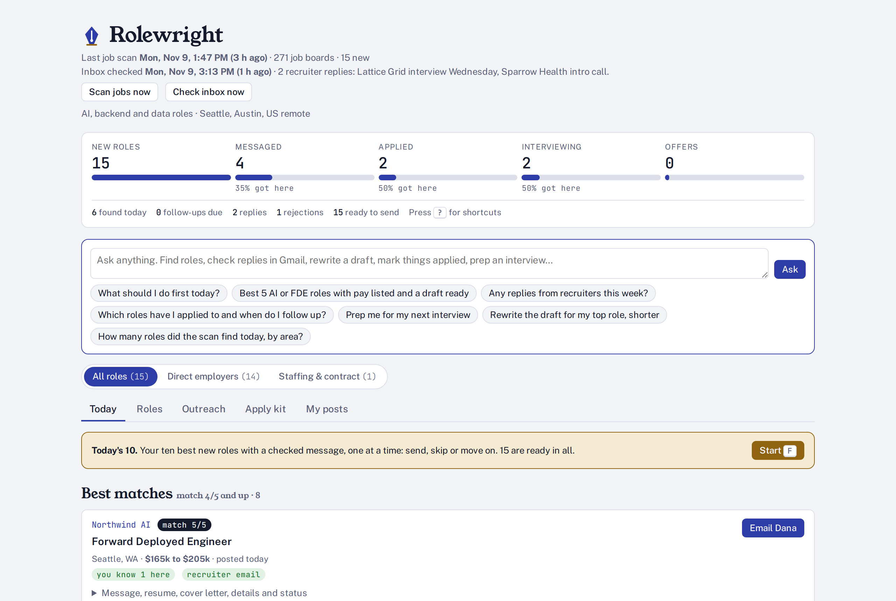
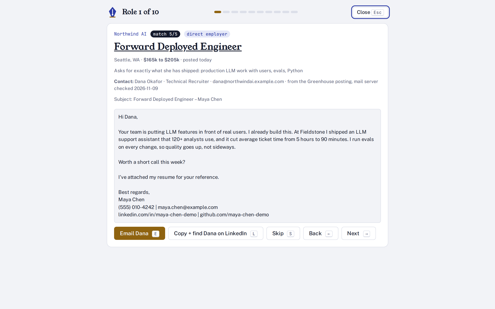
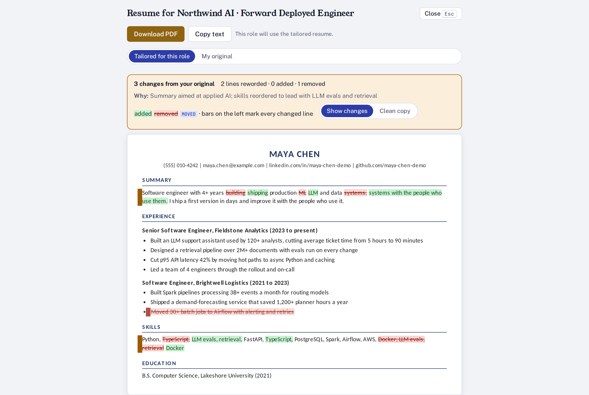
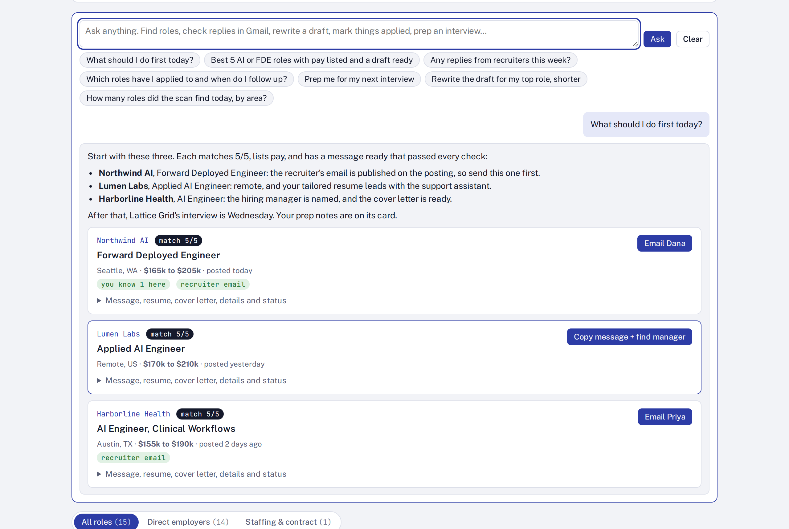
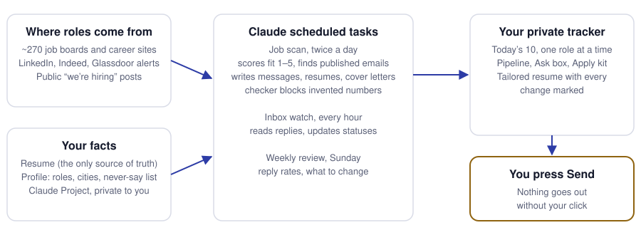

<div align="center">

<picture>
  <source media="(prefers-color-scheme: dark)" srcset="docs/media/hero-dark.svg">
  
</picture>

**An AI job-search agent that runs on your own Claude subscription.**<br>
It finds the roles, writes the messages and tailors the resume. You press Send.

[Website](https://dev-null-k2.github.io/rolewright-job-agent/) ·
[Set up with one prompt](#set-up-with-one-prompt) ·
[How it runs](#how-it-runs) ·
[FAQ](#faq) ·
[Full setup guide](SETUP.md)

[](https://github.com/dev-null-k2/rolewright-job-agent/actions/workflows/ci.yml)
[](LICENSE)


<picture><source media="(prefers-color-scheme: dark)" srcset="docs/media/home-dark.png"></picture>

</div>

## Why it exists

A good job search is a lot of small, careful work: check dozens of career pages every day, judge which roles
really fit, find a real person to write to, write something specific, tailor the resume, follow up on time.
Most tools either spray applications or leave all that work to you.

Rolewright does the careful version for you, every morning, using only what is on your resume. You spend ten
minutes reviewing and sending.

### What's new here

Job boards list roles. Auto-apply bots spam them. Trackers are spreadsheets you fill in yourself. As far as we
know, nothing else does all of this together:

| | |
|---|---|
| **It never invents anything.** | Every message, cover letter and tailored resume is checked against your resume. A number that isn't on your resume, a cliché, or a mention of your location or visa blocks the draft, and the page won't let you send it. |
| **You stay in control.** | Nothing is ever sent for you. Every email opens in Gmail fully written: greeting, message, a line saying your resume is attached, and your signature with phone, email, LinkedIn and GitHub. You attach the resume and press Send. |
| **Every resume change is visible.** | Tailored resumes are shown against your original: green for added, red for removed, moved lines tagged. One click switches a role back to your original. |
| **Real people, not guesses.** | It uses only recruiter emails that the posting publishes, after checking the domain has a working mail server. It never guesses addresses. |
| **No server, no API keys, no new bill.** | It runs as Claude scheduled tasks and a private Claude artifact in your own account. Your resume never leaves it. |
| **It respects LinkedIn's rules.** | It never logs in to or scrapes LinkedIn. Roles come from your own alert emails and public posts, and warm intros from LinkedIn's own data export. |

## See it work

Every screen below is the real tracker page (`app/rolewright.html`), captured by
[`scripts/showcase/shoot.js`](scripts/showcase/shoot.js) with **fictional demo data**: Maya Chen and every
company shown are made up.

### Today's 10: your best roles, one at a time

<picture><source media="(prefers-color-scheme: dark)" srcset="docs/media/focus-dark.png"></picture>

Press `F`. Each role shows why it matches, who to write to, and a short message that has already passed every
check. Press `E` to open it in Gmail, `L` to copy it and find the person on LinkedIn, `S` to skip with a reason.

### A tailored resume, with every change marked

<picture><source media="(prefers-color-scheme: dark)" srcset="docs/media/resume-dark.png"></picture>

The top roles each get a resume version that reorders and rewords. It never adds a skill, number or employer
you don't have. Download the PDF, or switch back to your original with one click.

### Ask anything

<picture><source media="(prefers-color-scheme: dark)" srcset="docs/media/ask-dark.png"></picture>

The Ask box can search, explain and update everything in plain English. For example "contract roles over 150k",
"mark the Stripe role as applied", "prep me for Wednesday" or "any replies this week?". It checks Gmail
read-only when the question needs it.

## Set up with one prompt

You need a paid Claude plan with the **Claude desktop app**, and a **Gmail** account. No coding.

1. In the Claude desktop app, connect **Gmail**: Settings → Connectors → Gmail → Connect.
2. Create a Claude Project called **Job search**.
3. Start a **Cowork** task in that project, attach your resume, and paste:

```text
Set up Rolewright for me end to end. Get it from https://github.com/dev-null-k2/rolewright-job-agent
(clone it, or ask me to attach the ZIP if you can't reach GitHub). Read SETUP.md and do everything under
"What Claude does in step 4": ask me the few questions it lists, write my profile from my attached resume
only, save the files to this project, publish my Rolewright tracker, create the three scheduled tasks in my
time zone, run the first job scan, and open the tracker for me when it's done. Never invent anything that
isn't on my resume.
```

Claude asks a few short questions (target roles, cities or remote, time zone, links, anything never to mention),
then does everything else, including the first scan. It takes about 20 minutes. When it's done, open the tracker
and press `F`.

**Then, once (recommended):** turn on LinkedIn, Indeed and Glassdoor job-alert emails, and upload your LinkedIn
connections export for warm intros. [SETUP.md](SETUP.md) shows each click, plus day-to-day use and
troubleshooting.

## What it does

**Finds roles**
- Scans about 270 boards twice a day: Greenhouse, Lever, Ashby and Workday sites, Amazon, Microsoft, Google,
  Apple, Oracle, JPMorgan, Hacker News "Who is hiring", Dice, and the TEKsystems, Actalent and Aston Carter staffing sites.
- Reads your LinkedIn, Indeed and Glassdoor job-alert emails (read-only), so those roles land in the tracker too.
- Finds recent public "we're hiring" posts on LinkedIn through web search and drafts a note to the poster.
- Scores every role 1–5 against your resume and explains why. Roles at 4/5 and up come first.
- Shows pay when the posting lists it, contract or full time, and the employer's past H-1B filings (US Department
  of Labor data) for people who need sponsorship. One switch separates direct employers from staffing firms.

**Writes for you, from your facts only**
- A short, specific message for every role, plus follow-ups, referral asks, interview prep, cover letters and
  "Why this company?" answers for the best ones.
- A tailored resume per top role, with every change marked against your original.
- A checker that blocks invented numbers, clichés, location, visa or work-authorization mentions, and wrong
  signatures.

**Finds the right person**
- The recruiter email the posting publishes, checked for a working mail server. Never a guess.
- For big employers that don't publish emails, recruiters and hiring managers from public web search, for you to
  message on LinkedIn yourself.
- People you already know at each company, from your LinkedIn connections export.

**Keeps you moving**
- **Today's 10** focus mode with keyboard shortcuts (`F` to start, `?` for all of them).
- An hourly inbox watch that moves roles to interviewing or rejected from recruiter replies and drafts your answer.
- A pipeline view, a Sunday weekly review with reply rates, the Ask box, and an **Apply kit** of ready answers to
  the questions every application form asks.

## What it will not do
- Send email, submit applications or message anyone. You press Send.
- Log in to or scrape LinkedIn or any job site.
- Answer work-authorization questions. Those are always yours.
- Claim anything that isn't on your resume.

## How it runs

<picture><source media="(prefers-color-scheme: dark)" srcset="docs/media/how-dark.svg"></picture>

Everything runs inside your Claude account:
- **The tracker** is a private Claude artifact (`app/rolewright.html`) with its own small database.
- **The agent** is three Claude scheduled tasks (`scheduled_tasks/`) that follow `agent/RUNBOOK.md` and run the
  Python scripts in `agent/`.
- **Your facts** live in your Claude Project: `profile.json`, `profile.md` and `RESUME_MASTER.md`.

## FAQ

**What does it cost?** Nothing beyond your Claude plan. The scans use your normal Claude usage, like any other task.

**Does it apply for me?** No. It prepares everything and opens Gmail or the posting. You decide and you send.

**Is my data private?** Yes. The tracker is a private artifact and your files live in your private Claude project.
Rolewright has no server, and Gmail access is read-only.

**Does it work outside the US?** The job boards and career sites work anywhere they post. The H-1B data and the
staffing-site filters are US-specific. Set your cities in the setup and it searches there.

**Can I change cities, roles or my resume later?** Yes. Ask Claude in your Job search project, for example
"Add Chicago to my Rolewright search" or "Here is my new resume, update Rolewright."

**How do I stop it?** Ask Claude to pause Rolewright, or turn off its three scheduled tasks in the app.

## Repository layout
| Path | What it is |
|---|---|
| `app/rolewright.html` | The tracker page (published as a Claude artifact) |
| `agent/RUNBOOK.md` | What the scheduled scan does, step by step |
| `agent/scan_jobs.py` | The job-board scanner |
| `agent/find_contacts.py` | Finds published recruiter emails and checks their mail servers |
| `agent/linkedin_posts.py` | Dates and filters public LinkedIn posts found by web search |
| `agent/check_drafts.py` | The checker every message, resume and cover letter must pass |
| `agent/h1b_sponsors.json` | Past H-1B filings by employer (public US Department of Labor data) |
| `config/` | Templates for your profile, resume and application answers |
| `scheduled_tasks/` | The three scheduled-task prompts |
| `scripts/showcase/` | Fictional demo data and the script that captures the screenshots above |
| `docs/` | The project website and README images |

## Contributing
Issues and pull requests are welcome. See [CONTRIBUTING.md](CONTRIBUTING.md), [SECURITY.md](SECURITY.md) and the
[code of conduct](CODE_OF_CONDUCT.md).

## License
MIT. See [LICENSE](LICENSE). The resume PDF uses the Carlito font (SIL Open Font License 1.1), embedded in the page. Built by [Karthik Kasukurti](https://github.com/dev-null-k2).
